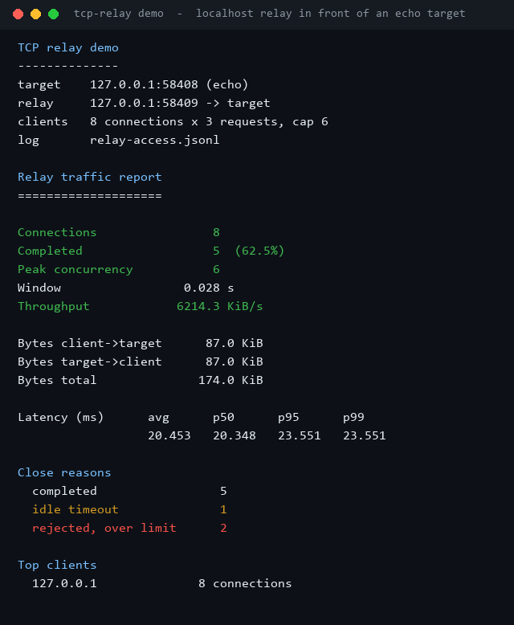
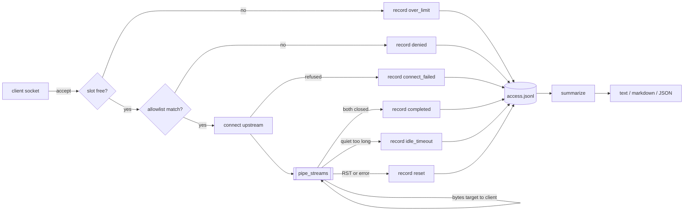
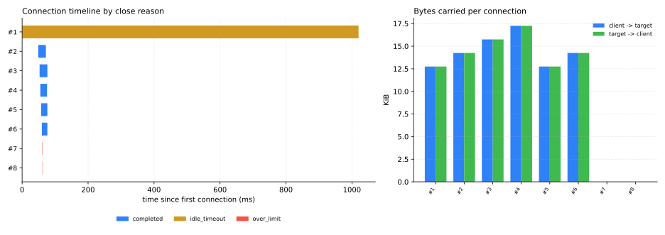

# TCP-Relay-Monitor

[](https://github.com/abubakarsiddique360/TCP-Relay-Monitor/actions/workflows/ci.yml)


A small TCP relay that knows what it forwarded. Point it at a service, and every connection is
capped, timed, and written to a JSONL access log; one command folds that log into a traffic report
with throughput, latency percentiles and close reasons.

```text
client -> 127.0.0.1:8081 -> relay -> upstream 127.0.0.1:8080
                               `-> relay-access.jsonl -> tcp-relay report
```

## What a real run looks like

This is the captured output of `tcp-relay demo` on the machine that built this repository: eight
loopback clients, three requests each, a concurrency cap of six, and one client that deliberately
goes quiet so the idle timer has something to do.



## Why it exists

A TCP relay is usually three lines of `socket` code until you need to answer questions about it:
how many clients were refused, how much traffic actually crossed the process, which connections
died silently, and whether the last spike was real. Adding a proxy also means adding a blind spot.

This project keeps the relay deliberately small and makes the accounting the product: a bounded
threaded relay, one JSON object per closed connection, and a report you can paste into an incident.
No agent, no exporter, no dependency.

## How it works



`pipe_streams` is the whole relay: `select` on both sockets, copy in both directions, propagate
half-close with `shutdown(SHUT_WR)`, refresh the idle deadline on every byte, and return
`(bytes_up, bytes_down, reason)`. Because it is a pure function over two sockets it can be tested
without a listening port - see `tests/test_relay.py`.

Every path - including refusals - ends in exactly one access record, so the log is the source of
truth rather than a best-effort side channel.

## Results from the committed run

Measured on Windows 11, Python 3.11, loopback interface only (`docs/demo-summary.json`):

| Metric | Value |
| --- | --- |
| Connections | 8 |
| Completed | 5 (62.5%) |
| Rejected, over limit | 2 |
| Idle timeout | 1 |
| Bytes client to target | 87.0 KiB |
| Bytes target to client | 87.0 KiB |
| Latency p50 | 20.3 ms |
| Latency p95 | 23.6 ms |
| Peak concurrency | 6 (the configured cap) |
| Throughput over the active window | 6214.3 KiB/s |



The timeline is the interesting part: connections 1-5 complete in a few milliseconds each, the
two red bars are refused before any byte moves, and the long amber bar is the client that stopped
talking and was cut off by the idle timer. Latency is reported over completed connections only, so
a refusing relay cannot flatter its own percentile.

Numbers come from a loopback echo target in the same process tree; a Python relay adds the GIL and
`select` on top of two socket hops, so treat these as order-of-magnitude, not as a benchmark of the
kernel. Re-run `python scripts/render_assets.py` to regenerate every number and image above.

## Install

```bash
pip install -e .
```

Python 3.10+, standard library only.

## Usage

```bash
tcp-relay check  --config examples/relay.json          # validate without opening a socket
tcp-relay serve  --config examples/relay.json          # run until Ctrl+C
tcp-relay demo   --connections 8 --rounds 3            # loopback experiment + report
tcp-relay report --log relay-access.jsonl              # text report
tcp-relay report --log relay-access.jsonl --format markdown
tcp-relay report --log relay-access.jsonl --format json
```

Exit codes: `0` success, `1` the log is missing or empty, `2` the configuration cannot be used.

`serve` prints one line per finished connection:

```text
#12   127.0.0.1:52344 completed      up=12288B down=12288B 21.4ms
#13   127.0.0.1:52345 over_limit     up=0B down=0B 0.0ms
```

## Configuration

```json
{
  "listen_host": "127.0.0.1",
  "listen_port": 8081,
  "target_host": "127.0.0.1",
  "target_port": 8080,
  "max_connections": 64,
  "idle_timeout": 120,
  "connect_timeout": 5,
  "allowlist": ["127.0.0.0/8", "::1/128"],
  "log_path": "relay-access.jsonl"
}
```

| Field | Default | Meaning |
| --- | --- | --- |
| `listen_host`, `listen_port` | - | where the relay accepts; `0` picks a free port |
| `target_host`, `target_port` | - | the single upstream every client is forwarded to |
| `max_connections` | `64` | hard cap; extra clients are closed and logged as `over_limit` |
| `idle_timeout` | `300` | seconds of silence before a connection is closed |
| `connect_timeout` | `5` | seconds allowed for the upstream TCP handshake |
| `allowlist` | `[]` | CIDR blocks; empty means every client is allowed |
| `log_path` | `relay-access.jsonl` | append-only access log |
| `backpressure_chunk` | `65536` | read size per `recv` |

`check` reports every problem at once, for example
`missing required field: target_port; idle_timeout must be a positive number`.

## Access log schema

One JSON object per line, written when the connection closes:

```json
{"connection_id":12,"client_ip":"127.0.0.1","client_port":52344,"target_host":"127.0.0.1",
 "target_port":8080,"opened_at":1767225600.12,"closed_at":1767225600.141,"bytes_up":12288,
 "bytes_down":12288,"reason":"completed","duration_ms":21.4}
```

| Reason | Meaning |
| --- | --- |
| `completed` | both directions closed cleanly |
| `idle_timeout` | no bytes in either direction for `idle_timeout` |
| `reset` | peer sent RST or the socket failed mid-copy |
| `denied` | client IP was not in the allowlist |
| `over_limit` | the concurrency cap was already reached |
| `connect_failed` | the upstream refused or timed out |

Malformed lines are skipped and counted, so a half-written file never breaks the report.

## Design notes and limits

- One upstream per relay. For routing by name or port, run one relay per target and put the
  accounting behind a shared `log_path`.
- Thread per connection. That is fine for dozens to low hundreds of connections; beyond that the
  GIL and thread stack cost dominate and an asyncio rewrite is the next step.
- The allowlist is checked per accepted socket, before the upstream connect, so denied clients cost
  one `accept` and no upstream file descriptor.
- No TLS termination, no HTTP parsing, no payload inspection: the relay forwards bytes and counts
  them. Keeping it protocol-agnostic is what makes it safe to put in front of anything.
- `peak_concurrency` is computed by replaying open/close timestamps, so it stays correct even if you
  concatenate several log files before reporting.

## Development

```bash
python -m pip install -e ".[dev]"
ruff check .
pytest                                    # 44 tests, no network access required
python scripts/render_assets.py           # regenerate docs/images and docs/demo-summary.json
```

Tests start real loopback sockets on ephemeral ports and never touch the internet.

## License

MIT - see [LICENSE](LICENSE).
